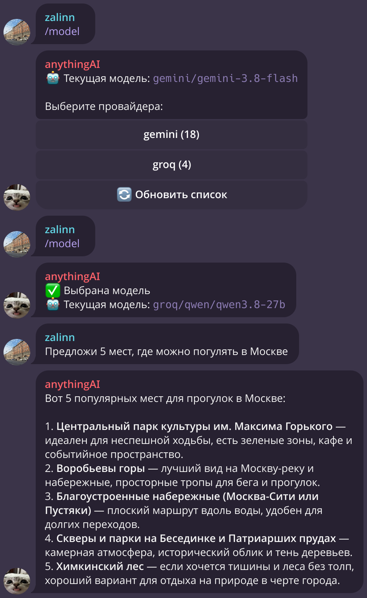

# anythingAI - телеграм-бот для общения с любыми LLM

Один бот в Telegram, через который можно общаться с моделями от разных провайдеров: Gemini, Groq, OpenAI, Anthropic, DeepSeek, Qwen и вообще с любым API, совместимым с OpenAI




---

## ❗ Зачем

У каждого провайдера свой сайт, свой чат и свои лимиты. Хотелось открыть Telegram и написать модели прямо оттуда, а если одна упёрлась в лимит, переключиться на другую в пару кликов

Заодно это был повод нормально разобраться с OpenAI и Anthropic API: стримингом, подсчётом токенов, контекстным окном и тем, как всё это ведёт себя у разных провайдеров

## ✅ Что умеет

- Отвечает потоково: сообщение дописывается по мере генерации, а не приходит целиком через 20 секунд
- При запуске сам спрашивает у каждого провайдера список моделей. Выбрать модель можно через `/model`
- `/start` и `/reset` сбрасывают диалог и начинают с чистого листа
- `/stats` показывает текущую модель, насколько заполнен контекст, сколько потрачено токенов и денег за сессию, за сегодня и за всё время
- Если история перестала влезать в контекст модели, старые сообщения отбрасываются, и бот об этом предупреждает
- Отвечает только тем, кого вы указали в `.env`

История, выбранная модель и статистика лежат в SQLite и переживают перезапуск контейнера

## 🚀 Быстрый старт

Понадобится токен бота от [@BotFather](https://t.me/BotFather) и хотя бы один API-ключ. Бесплатно ключ можно взять у [Gemini](https://aistudio.google.com/apikey) или [Groq](https://console.groq.com/keys)

```bash
# 1. Клонируем репозиторий
git clone https://github.com/MySelfZalin/anythingAI-telegram.git
cd anythingAI-telegram

# 2. Создаём конфиги из шаблонов
cp .env.example .env
cp providers.example.yaml providers.yaml
# вписываем в .env токен бота и ключи

# 3. Собираем и запускаем
docker compose up -d --build

# 4. Смотрим логи
docker compose logs -f
```

## ⚙️ Конфигурация

### `.env`

| Переменная | Обязательная | Описание |
|---|---|---|
| `BOT_TOKEN` | ✅ да | Токен от @BotFather |
| `ALLOWED_USER_IDS` | нет | Telegram ID через запятую. Пусто - бот отвечает всем |
| `DEFAULT_MODEL` | нет | Модель по умолчанию, например `gemini:gemini-3.6-flash` |
| `SYSTEM_PROMPT` | нет | Системный промпт для всех диалогов |
| `GEMINI_API_KEY`, `GROQ_API_KEY`, ... | нет | Ключи провайдеров. Провайдер без ключа просто не подключается |

> 💡 Свой Telegram ID можно узнать у [@userinfobot](https://t.me/userinfobot). Лучше не оставлять `ALLOWED_USER_IDS` пустым, иначе ваши ключи сможет тратить кто угодно

### `providers.yaml`

Здесь перечислены провайдеры. Чтобы добавить новый, достаточно дописать блок:

```yaml
- name: groq                                # имя в меню бота
  type: openai                              # openai или anthropic
  base_url: https://api.groq.com/openai/v1
  api_key_env: GROQ_API_KEY                 # из какой переменной .env брать ключ
  exclude: ["whisper", "tts"]               # скрыть лишние модели
```

Для моделей можно указать размер контекста и цену за 1M токенов, тогда `/stats` будет считать расходы в долларах. Примеры есть в `providers.example.yaml`

> 💡 После правки `.env` хватит `docker compose up -d --build`. Если менялся только `providers.yaml`, нужен `docker compose restart`

## 🗂️ Структура проекта

```
.
├── src/bot/
│   ├── providers/      # клиенты OpenAI и Anthropic, загрузка списка моделей
│   ├── handlers/       # команды, выбор модели, сам чат
│   ├── storage.py      # SQLite: история, настройки, статистика
│   ├── streaming.py    # потоковый вывод ответа в Telegram
│   └── config.py       # чтение .env и providers.yaml
├── tests/
├── Dockerfile          # non-root образ на uv
└── docker-compose.yml  # сервис + volume для базы
```

## 🧪 Разработка

```bash
uv sync
uv run pytest
uv run ruff check .
```
